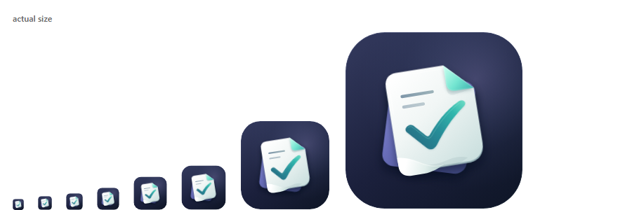

# ESN

> **Electronic Sticky Note** —— 贴在桌面上的待办便签。多张并存、勾完即走、常驻内存不超过 10 MiB。




## 现状（M0 已完成）

| 能力 | 状态 |
| --- | --- |
| 单实例 + 托盘常驻 | ✅ |
| 多张便签（上限 12） | ✅ |
| 无边框卡片：拖动、八向缩放、DWM 圆角、暗色标题栏 | ✅ |
| 待办：添加 / 双击编辑 / 勾选 / 删除 / 自动保存 | ✅ |
| 完成项显示：删除线 / 隐藏（右键菜单与托盘切换） | ✅ |
| 皮肤：浅色 / 深色 / 宣纸 / 跟随系统 | ✅ |
| 自定义便签名（双击标题） | ✅ |
| 条目提醒：每行右侧时钟图标点开即设（10/30/60 分钟、明天 9:00）；到点自动显示 + 置顶 + 系统通知 | ✅ |
| 标题栏图钉图标（点亮 = always-on-top） | ✅ |
| 开机启动（托盘勾选，写 HKCU\Run） | ✅ |
| 收起到托盘：标题栏 `—` / 右键 / `Ctrl+H`，**单击托盘即恢复** | ✅ |
| 全局热键 `Ctrl+Alt+N` / `Ctrl+Alt+H` | ✅（冲突提示未做） |
| 设置窗口、开机自启、撤销、拖拽排序 | ⏳ M1/M2 |

## 提醒怎么用

点条目右侧的 `◷` 时钟图标（新建条目时它就在编辑框右边），选 10 / 30 / 60 分钟后、明天 9:00，或「自定义…」挑具体日期和时间；右键「提醒我」「Ctrl+Shift+R」是同一入口。设置后行尾显示 `HH:mm`（过期变红）。
到点时：便签自动从托盘弹出 → 置顶、任务栏闪烁 → 右下角弹系统通知；15 秒后自动取消临时置顶（除非这张便签本来就是置顶状态）。勾掉条目会自动取消它的提醒。

## 收起 / 恢复

- 标题栏右上角 `—`，或右键「隐藏到托盘」，或 `Ctrl+H`
- 标题栏的图钉是置顶开关，点亮后便签始终压在最上层
- 恢复：**单击托盘图标**（或双击、托盘菜单「显示全部」、`Ctrl+Alt+H`）
- 隐藏期间提醒照常触发，到点会自己弹出来

内存（Release，私有字节）：单张便签 **6.9 MiB**，12 便签 × 200 条 **8.5–9.0 MiB**，上限 10 MiB。

提醒示例（行尾 `HH:mm`）：


自定义时间（系统日期/时间选择器 + 自绘标题条）：


## 构建

需要 Visual Studio 2022 Build Tools（MSVC v143）、Windows SDK 10、CMake 3.25+、Ninja。

```powershell
.\scripts\build.ps1            # 配置 + Release 构建，产物在 build\dist\ESN.exe
.\scripts\build.ps1 -Clean     # 从零重建
```

手工构建（已装好 VS 开发者环境）：

```powershell
cmake -S . -B build -G Ninja -DCMAKE_BUILD_TYPE=Release
cmake --build build
```

说明：CMake 生成的 VS 工程也能编，但仓库默认用 Ninja；原因是 MSBuild 对「资源里已带 RT_MANIFEST + 链接器再生成清单」的组合会报 LNK1123，工程里已经用 `/MANIFEST:NO` 规避，Ninja 路径验证最充分。

## 运行与数据

- 直接双击 `build\dist\ESN.exe`，无安装、无运行时依赖（静态 CRT）。
- 数据：`%LOCALAPPDATA%\ESN\data.json`（`.bak` 备份，`.tmp` 中间态）。
- 调试开关（可选）：
  - `ESN_DATA_DIR=<目录>`：换数据目录（测试用）
  - `ESN_LOG=<文件>`：把启动与关键路径日志写文件

## 内存

```powershell
.\scripts\measure-memory.ps1 -Notes 12 -Items 200
```

脚本会生成对应规模的 `data.json`，启动程序，静置 5 s 后采样 15 s，输出私有字节峰值与判定。当前基线：

| 场景 | 私有字节 |
| --- | --- |
| 1 便签 × 0 条 | 6.39 MiB |
| 6 便签 × 50 条 | 7.57 MiB |
| 12 便签 × 50 条 | 7.98 MiB |
| 12 便签 × 200 条 | 8.11 MiB |

## 关键实现决定

**渲染目标必须是 `ID2D1DCRenderTarget`，且全局共享一个。** `ID2D1HwndRenderTarget` 会创建 D3D11 设备与交换链，实测让进程从 2.8 MiB 直接涨到 36.9 MiB，10 MiB 预算当场失守。换成软件光栅的 DC 渲染目标后，全部窗口共用 4.6 MiB 级别的底座，D2D/DWrite 的排版、删除线、ClearType 效果都不受影响。

文字编辑用原生 `EDIT` 浮层做兜底：一行一个编辑位置，天然拿到输入法、选区、剪贴板，避免自绘编辑器在 IME 上的长尾问题；M2 再评估是否换成完全自绘。

## 目录

```
src/
  main.cpp           启动、单实例、DPI/COM 初始化
  app.{h,cpp}        托盘、热键、菜单、便签窗口管理、共享渲染目标
  note_window.{h,cpp}便签窗口：绘制、命中测试、滚动、编辑、持久化触发
  store.{h,cpp}      JSON 读写、原子替换、容量上限
  common.{h,cpp}     字符串/DPI/调色板/日志
res/                 图标（esn.ico / SVG 源）、manifest、版本信息
scripts/             构建与内存测量
docs/ESN-方案.md   完整方案（含 M0 实测记录）
third_party/yyjson/  唯一的第三方依赖（MIT）
```

## 隐私与安全

- **不联网**：代码里没有任何 socket / WinHTTP / WinINet 调用，也没有更新检查
- **不收集**：无遥测、无崩溃上报、无日志外传
- **数据只在本地**：`%LOCALAPPDATA%\ESN\data.json`（含 `.bak` 备份）
- **唯一的系统写入**：勾选「开机启动」时写 `HKCU\Software\Microsoft\Windows\CurrentVersion\Run` 的 `ESN` 值，取消即删除

## 许可

MIT，见 [LICENSE](LICENSE)。第三方依赖 yyjson 同 MIT，见 [third_party/yyjson/LICENSE](third_party/yyjson/LICENSE)。
