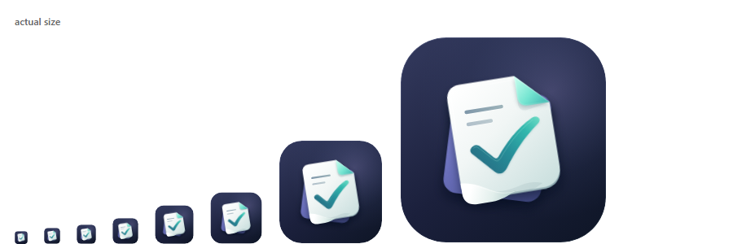

# ESN · 桌面便签待办 — 产品与技术方案

> 版本 v1.0 ｜ 2026-11-20 ｜ 目标平台：Windows 10 1809+ / Windows 11 x64

---

## 0. 一页结论

| 维度 | 结论 |
| --- | --- |
| 定位 | 一张贴在桌面上的待办便签，多张并存，勾完即走，不做云、不做协作 |
| 名称 | **ESN**（大小写固定），全称 Electronic Sticky Note，读作 "E-S-N" |
| 技术栈 | **C++20 + Win32 + Direct2D/DirectWrite**，单进程、单 exe、无运行时依赖 |
| 内存 | 口径**私有字节（Private Bytes）≤ 10 MiB**；空窗基线 2.5 MiB；M0 实测 12 便签 × 200 条峰值 **8.11 MiB** |
| 皮肤 | 浅色 / 深色 / 宣纸 / 跟随系统，四套共用布局，只换 token |
| 完成项 | 隐藏 / 删除线两种视图，设置里切换，数据永不丢 |
| 图标 | 「折光便签」：深靛底座 + 双纸叠放 + 青绿折角与流线对勾，八尺寸同源 |
| 首版周期 | 业余节奏约 4–5 周（M0 骨架 3–4 人日 → M1 MVP 8–10 人日 → M2 打磨 5–7 人日 → M3 验收 3–4 人日） |

**为什么是原生而不是 Web 壳**：10 MiB 是硬指标，WebView2/Tauri 光运行时进程就 60 MB 起步，直接出局；原生 Win32 + D2D 是唯一能在 10 MiB 内还保证文字渲染质量和输入法体验的路线。

---

## 1. 命名与定位

**ESN = Electronic Sticky Note**（电子便签）。三个字母就是品类本身，不再拆成"Memo + Windows + Todo"这类解释——对外说全称，界面只出现 ESN。

- 字标 **ESN** 用于图标、托盘、关于页；正文一律写 `ESN`，不改大小写。中文口头名仍是「电子便签」。
- 中文口头名：**M 便签**（对外全称仍用 ESN）。
- 文件与注册表：`ESN.exe`、`%LOCALAPPDATA%\ESN\`、`HKCU\Software\ESN`。
- 一句话：**把今天要做的事，贴在眼前。**

**v1 明确不做**：账号、云同步、富文本/图片、标签体系、多人协作、插件、移动端。这些都会把内存和交互复杂度拉出预算。

---

## 2. 需求拆解与验收口径

| # | 你的需求 | 落成规格 | 验收方式 |
| --- | --- | --- | --- |
| 1 | 自定义便签名字 | 标题栏双击进入改名，48 字符上限，失焦即存；重名允许，内部用稳定 ID 区分 | 改 12 张便签名字，重启后完全还原 |
| 2 | 便签可生成多个 | 托盘「新建便签」或 `Ctrl+N`，每张一个独立无边框窗口，可各自移动/缩放/置顶/折叠 | 同时开 12 张，互不干扰，关闭单张不影响其他 |
| 3 | 低占用 ≤10 MB | 私有字节 ≤10 MiB；空载 ~3 MB，12 便签×200 条 ~7.5 MB | 按 §5.4 场景矩阵实测，取峰值 |
| 4 | 勾掉后隐藏 / 删除线 | 设置项 `checked: strike \| hide`；hide 只过滤视图，数据保留，任务栏显示「已完成 n」 | 切换两种模式并重启，条目数量与内容不丢 |
| 5 | 四种皮肤 | 浅色 / 深色 / 宣纸 / 跟随系统；主题切换 <100 ms，无闪烁 | 四套逐一切换 + 系统主题变化自动跟随 + 高对比度可读 |
| 6 | 到点提醒 | 条目级提醒（10 / 30 / 60 分钟后、明天 9:00、清除）；到点自动显示便签、置顶、闪烁任务栏并弹系统通知；标记完成即取消提醒 | 设 5 秒后提醒并先隐藏窗口：到点窗口自动出现且为置顶，通知弹出，`remind` 字段被清空 |
| 7 | 收起到托盘 | 标题栏 `—`、右键「隐藏到托盘」、`Ctrl+H` 三种隐藏方式；托盘双击或菜单「显示全部」恢复 | 隐藏后数据保留，托盘恢复位置尺寸不变 |

补充的默认能力（不占额外预算，但缺了会难用）：托盘常驻、开机自启、全局新建热键、自动保存、崩溃恢复、撤销、每显示器 DPI、单实例。

---

## 3. 技术选型

### 3.1 先把"内存"三个口径说清

同一时刻任务管理器可能给你三个不同数字，验收前必须锁定一个，否则会吵不清：

| 口径 | 含义 | 典型值（本机空窗） |
| --- | --- | --- |
| **私有字节 Private Bytes** | 进程已提交、不可共享的内存（本方案验收口径） | **2.5 MiB** |
| 专用工作集 Private Working Set | 任务管理器"内存"列显示的值 | 2.0 MiB |
| 工作集 Working Set | 含被共享映射的系统 DLL（user32、d2d1、dwrite…） | 15 MiB |

> 任何原生 GUI 程序的工作集都会被系统 DLL 抬到 15 MB 以上，这是共享页，不是应用自己占的。**所以"≤10 MB"必须按私有字节验收**，否则没有程序能过。

### 3.2 候选框架对比

下表是各栈的常见空载区间（量级参考），最后一行为本机实测：

| 方案 | 空载私有内存 | 交付形态 | 结论 |
| --- | --- | --- | --- |
| Electron | 120–250 MB | 150 MB+ 目录 | ✗ |
| Tauri / WebView2 壳 | 60–120 MB（多进程） | 5 MB + 系统 WebView2 | ✗ 依赖运行时 |
| WinUI 3 | 45–80 MB | 30 MB+，需 WindowsAppSDK | ✗ |
| WPF | 35–60 MB | 依赖 .NET 桌面运行时 | ✗ |
| Avalonia | 40–70 MB | 依赖 .NET | ✗ |
| WinForms (.NET 8) | 18–35 MB | 自包含 60 MB+ | ✗ 临界 |
| Qt Widgets | 15–30 MB | 20 MB+ DLL | ✗ |
| Dear ImGui + D3D11 | 12–25 MB | 单 exe | △ 文字/输入法弱 |
| **Win32 + Direct2D/DirectWrite（C++）** | **2.5 MiB（实测）** | 300–600 KB 单 exe | **✓ 选它** |
| Win32 + Direct2D（Rust/windows-rs） | 预计 3–6 MB | 400–800 KB 单 exe | ✓ 等效备选 |

### 3.3 本机基线实测（可复现）

为确认 10 MiB 不是纸上指标，先做了一个最小验证：一个 Win32 窗口 + D2D/DWrite 工厂，无任何业务逻辑。

- 编译：`g++ baseline.cpp -municode -mwindows -O2 -s -static -DUSE_D2D -ld2d1 -ldwrite -lole32 -luuid`
- 采样：启动后 3 s 静置，`GetProcessMemoryInfo` + `\Process(*)\Working Set - Private` 计数器，2 轮

| 构建 | 私有字节 | 专用工作集 | 工作集 | GDI/USER 句柄 |
| --- | --- | --- | --- | --- |
| Win32 + D2D + DWrite | 2.55 MiB | 2.00 MiB | 15.4 MiB | 10 / 13 |
| Win32 + GDI | 2.37 MiB | 1.84 MiB | 14.2 MiB | 10 / 13 |

结论：**底座 2.5 MiB，留给业务内容的空间约 7.5 MiB**，预算成立。完整实现只要不犯 §5.2 里列的错，就能守住 10 MiB。

探针源码与采样脚本在 `probe/`（`baseline.cpp`、`baseline-measure.ps1`），可直接复跑复核。

> 冷启动第一次运行会看到 8.9 MiB 之类的异常值，那是 Windows Defender 首次扫描 + 字体枚举，**稳定 5 s 后再采样**，验收脚本会处理这件事。

### 3.4 语言：C++ 为主，Rust 等效

| | C++20 | Rust + windows-rs |
| --- | --- | --- |
| 内存 | 同一架构，同为 3–6 MB | 同左 |
| 自绘编辑 + IME | 直接调 Imm32，资料多 | 需自己封 Imm32，样板多 |
| D2D/DWrite | 头文件直出，COM 调用自然 | windows-rs 绑定可用，但泛型噪音大 |
| 构建 | MSVC + CMake，5 分钟出包 | 工具链 + 交叉配置更重 |
| 安全 | 手动，靠 RAII 与约定 | 编译期更强 |

**决策：C++20 + MSVC + CMake**。和你的嵌入式背景衔接顺（指针、句柄、消息循环都是熟面孔），且 IME、托盘、D2D 的坑都有现成答案。若你更想用 Rust，架构、内存策略、数据格式全部不变，只换实现层。

### 3.5 依赖清单（越少越好）

- 系统库：`d2d1`、`dwrite`、`dwmapi`、`shell32`、`comctl32`、`imm32`、`shlwapi`
- 第三方：**yyjson**（单文件 C，MIT，解析快、内存可控）—— 只有它一个
- 不含：CRT 动态库（用 `/MT` 静态链接）、任何 UI 框架、任何字体文件、任何图片资源（图标编进 exe 的 .ico 资源，宣纸纹理运行时生成）

产物：`ESN.exe` 约 300–600 KB，`esn.ico` 内嵌，解压即用。

---

## 4. 架构设计

### 4.1 进程与窗口模型

```
ESN.exe（单进程，单 UI 线程）
├─ 隐藏的消息窗口  ── 托盘图标、热键、单实例、设置持久化中枢
├─ NoteWindow × N   ── 每张便签一个 WS_POPUP 顶层窗口（不是子窗口）
└─ SettingsWindow    ── 按需创建，关闭即 DestroyWindow
```

要点：

- **单进程多窗口**。多开进程会让底座成本乘以 N，10 MiB 立刻崩。
- 设置窗口、关于窗口**懒创建、关闭即销毁**，不常驻。
- 便签窗口隐藏时不销毁（保留滚动位置和数据），只释放渲染目标。
- 单实例：`CreateMutexW(L"Local\\ESN.Singleton")`；已存在则用 `WM_COPYDATA` 把"新建便签"意图发给已有实例后退出。

### 4.2 模块划分

```
esn/
├─ CMakeLists.txt
├─ src/
│  ├─ main.cpp                 // WinMain、单实例、消息循环
│  ├─ app.{h,cpp}              // 托盘、热键、自启、便签注册表
│  ├─ note_window.{h,cpp}      // 便签窗口：命中测试、拖拽、缩放、滚动
│  ├─ settings_window.{h,cpp}
│  ├─ ui/
│  │  ├─ layout.{h,cpp}        // 行高/虚拟滚动/可见区计算（纯函数，可测）
│  │  ├─ paint.{h,cpp}         // D2D 绘制：卡片、勾选框、删除线、滚动条
│  │  └─ editor.{h,cpp}        // 自绘编辑：光标、选区、剪贴板、IME
│  ├─ theme.{h,cpp}            // 4 套 token、系统主题跟随、高对比度、宣纸纹理
│  ├─ store.{h,cpp}            // JSON 读写、原子替换、备份、版本迁移
│  └─ util/                    // 字符串、DPI、日志（可选，Release 关闭）
├─ third_party/yyjson/
├─ res/
│  ├─ esn.rc                 // 图标 + 版本信息
│  └─ esn.manifest           // PerMonitorV2 + comctl32 v6 + longPathAware
└─ tests/
   ├─ layout_test.cpp
   └─ store_test.cpp
```

`layout` 和 `store` 不依赖窗口，单测覆盖；`paint` 只读状态、不写状态。

### 4.3 渲染管线

- `ID2D1Factory` + `IDWriteFactory` 全局各一个（单线程模式），所有窗口共享。
- **全局一个 `ID2D1DCRenderTarget`（软件光栅）**，每帧 `BindDC()` 绑定当前窗口的 HDC，所有窗口共用；`ID2D1HwndRenderTarget` 会拉起 D3D11 设备，实测单这一项 +35 MiB，已否决（见 §14）。
- 文本用 `IDWriteTextLayout`：**每个条目一份 layout**，只在文本/DPI/宽度变化时重建；滚动时不重建。
- 删除线用 `layout->SetStrikethrough(TRUE, {0, len})`，不是画线覆盖 —— 自动跟随字体度量。
- 勾选框、圆角卡片、滚动条全部几何绘制，无图片、无位图缓存。
- 双缓冲由 D2D 自带；`WM_ERASEBKGND` 返回 1，`WM_PAINT` 只做 `BeginDraw/EndDraw`。
- 处理 `D2DERR_RECREATE_TARGET`：丢 RT，下一帧重建（显卡驱动更新/远程桌面切换必踩）。

### 4.4 文本编辑与输入法（最硬的一块）

自绘编辑器要自己实现光标、选区、双击选词、`Ctrl+A/C/V/X/Z`、以及 **IME 候选窗定位**：

- `WM_IME_STARTCOMPOSITION` → `ImmGetContext` → `ImmSetCompositionWindow` 把候选窗贴到光标处；
- 组字串自己画（下划线 + 虚线），不走系统组字窗；
- 兜底方案：若中文输入在某输入法下异常，编辑态临时挂一个 1×1 的隐藏 `EDIT` 接管组字，确认后回写。这个兜底写进 M2 的风险清单，不提前实现。

### 4.5 主题切换时序

`系统设置变更` → `WM_SETTINGCHANGE("ImmersiveColorSet")` → 重读 `AppsUseLightTheme` → 若当前皮肤是"跟随系统"则替换为具体调色板 → `InvalidateRect` 所有便签 → 重绘。切换过程中不重建窗口、不重载字体，**内存零增长**。

### 4.6 线程

单 UI 线程足够。唯一考虑后台化的是"大 JSON 落盘"，但 12 便签的数据量在 100 KB 量级，`WriteFile` 是微秒级，**不引入线程**。没有定时器轮询；自动保存用 `SetTimer` 做 600 ms 防抖，保存后 `KillTimer`。

---

## 5. 内存预算与验收

### 5.1 预算表（私有字节）

| 项 | 预算 | 说明 |
| --- | --- | --- |
| 运行时底座（CRT + D2D/DWrite 工厂 + 消息窗口） | 2.5 MiB | 实测 |
| 主题资源（4 套 token + 宣纸纹理 64×64） | 0.2 MiB | 纹理程序生成 |
| 数据常驻（12 便签 × 200 条 × 512 字） | 0.35 MiB | UTF-16 + 结构体 |
| 便签窗口 × 6（含 RT、画刷、布局缓存） | 2.1 MiB | 0.35/窗口，隐藏即释放 RT |
| 文本布局缓存（可见 3 窗口 × 视口 20 行） | 0.6 MiB | 只缓存可见行 |
| 峰值余量（撤销栈、编辑缓冲、字体回退） | 1.5 MiB | |
| **合计** | **≈ 7.3 MiB** | 余量 2.7 MiB |

### 5.2 守住预算的 12 条硬规则

1. 单进程，绝不"每便签一个进程"。
2. 列表**虚拟化**：只为视口内的行建 layout；滚动复用，不批量创建。
3. layout 缓存按 `(itemId, width, dpi, textRevision)` 做键，改一个字只重建这一行。
4. 渲染目标全局共享、不随窗口创建/销毁；窗口不可见时只释放该窗口的 layout 缓存，数据保留。
5. 画刷按 RT 缓存（每 RT 至多 8 支），不每帧 `CreateSolidColorBrush`。
6. 不用 GDI 画正文（GDI 对象是全局稀缺资源），GDI 只留给托盘图标。
7. 不加载自定义字体文件（`IDWriteFontCollection` 会增加 1–3 MB）；只用系统字体，字体族做 fallback 链。
8. JSON 解析用 `yyjson_read_opts` 直接从文件映射解析，解析完立刻释放原始缓冲区；不保留 DOM。
9. 字符串用 `std::wstring` + 预留容量，编辑时不反复 realloc；撤销栈只存 **diff**（插入/删除片段），不存全文快照。
10. 关掉无谓的动画/阴影/模糊；圆角用 DWM 属性（`DWMWA_WINDOW_CORNER_PREFERENCE`），不自己画模糊。
11. Release 构建：`/O2 /GL /Gy /Gw /LTCG /MT`，剥离调试信息；不做 `/OPT:REF` 以外的花活。
12. 每个里程碑跑一次内存矩阵（§5.4），**回归超过 0.5 MiB 就查**，不要等到最后。

### 5.3 数据上限（预算的前提）

| 项 | 上限 | 超限行为 |
| --- | --- | --- |
| 便签数 | 12 | 托盘新建置灰 + 提示"最多 12 张" |
| 单便签条目 | 200 | 底部入口禁用 + 提示 |
| 单条文本 | 512 字符（UTF-16 单元） | 输入框硬截断 |
| 便签名 | 48 字符 | 同上 |

没有上限就无法承诺固定内存，这一条要写进产品说明。

### 5.4 验收协议

**口径**：`PROCESS_MEMORY_COUNTERS_EX.PrivateUsage`（私有字节），辅以 `\Process(name)\Working Set - Private` 记录。

**采样**：启动后静置 5 s → 连续 30 s、每 250 ms 取样 → 取**峰值** → 重复 3 次取最大值。全程不做其他重负载操作。

**场景矩阵**：

| # | 场景 | 判定 |
| --- | --- | --- |
| A | 冷启动，1 张空便签 | ≤ 4 MiB |
| B | 6 张便签 × 50 条，四皮肤各切一遍 | ≤ 8 MiB |
| C | 12 张 × 200 条 × 128 字符 | ≤ 10 MiB |
| D | C 场景下连续滚动 60 s + 编辑 512 字符（含中文 IME） | ≤ 10 MiB |
| E | 打开设置窗口 + 6 张便签 | ≤ 10 MiB |
| F | 隐藏全部 → 恢复全部 ×10 轮 | 无增长（泄漏检测） |
| G | 静置 24 h（无输入） | 不增长，CPU 占用 <0.1% |

**工具**：任务管理器（看趋势）、VMMap（看构成）、脚本（出报告）。验收脚本随仓库提供（`scripts/measure-memory.ps1`），输出 Markdown 表格存档到 `docs/memory-YYYYMMDD.md`。

---

## 6. 数据与持久化

### 6.1 目录

```
%LOCALAPPDATA%\ESN\
├─ data.json          主数据（设置 + 便签 + 条目）
├─ data.json.bak      上一次成功写入
├─ data.json.tmp      写入中间态（崩溃残留，启动时清理）
└─ logs\              仅 Release 出问题时手动开启
```

便携模式：若 exe 同目录存在 `ESN.portable`，则数据目录改为 `.\data\`。

### 6.2 Schema（v1）

```json
{
  "schema": 1,
  "settings": {
    "skin": "paper",                 // light | dark | paper | system
    "checked": "strike",             // strike | hide
    "autostart": false,
    "alwaysOnTop": false,
    "hotkeyNew": "Ctrl+Alt+N",
    "hotkeyToggle": "Ctrl+Alt+H",
    "fontScale": 1.0
  },
  "notes": [
    {
      "id": "n_01H8Z3",
      "name": "今天",
      "rect": [1280, 180, 320, 420],
      "pinned": true,
      "collapsed": false,
      "skin": null,                  // 单张覆盖全局皮肤，null=跟随
      "items": [
        { "id": "i_01H8Z4", "text": "写周报", "done": false, "doneAt": null, "indent": 0,
          "remind": 0 }             // Unix 毫秒；0 = 无提醒，到点后清零并通知
      ]
    }
  ]
}
```

- 完成状态与显示模式**分离存储**，切皮肤/切显示模式都不改数据。
- 所有时间戳为 ISO 8601；`doneAt` 供"隐藏"模式排序和统计用。
- `schema` 单调递增，加载时跑迁移链（v1→v2→…），**旧版本不会读新版本**（置只读 + 提示升级）。

### 6.3 写入策略

1. 任何修改 → 标记 dirty → `SetTimer(600ms)` 防抖；
2. 到时：序列化到 `data.json.tmp` → `FlushFileBuffers` → `ReplaceFileW(data.json, tmp, data.json.bak)`（原子替换，自带备份）；
3. 退出、切皮肤、切显示模式、结束编辑 → 立即落盘并 `KillTimer`；
4. 启动时若发现 `.tmp` 残留 → 删除；若 `data.json` 解析失败 → 尝试 `.bak`，再失败则重命名为 `data.corrupt-<时间>.json` 并以空数据启动（不静默丢文件）。

数据量上限下，全量序列化 <10 ms，不做增量写，逻辑简单、出错面小。

### 6.4 隐私

纯本地，无网络代码（Release 构建里连 WinINet 都不链接）。文件不含路径、用户名等个人信息。日志默认关闭。

---

## 7. 皮肤系统

### 7.1 四套 token

| Token | 浅色 | 深色 | 宣纸 | 用途 |
| --- | --- | --- | --- | --- |
| `bg` | `#FBFBFD` | `#1E2023` | `#F6EFDF` | 便签底 |
| `bgRaised` | `#F1F3F6` | `#26292D` | `#EFE5D0` | 标题栏/输入条 |
| `text` | `#1F2328` | `#E7EAEE` | `#2E3238` | 正文 |
| `textMuted` | `#7A828C` | `#8C939D` | `#7B6E57` | 计数/占位 |
| `textDone` | `#8A929B` | `#6F777F` | `#857A64` | 已完成 |
| `line` | `#E1E5EA` | `#33383E` | `#DCCFB2` | 分隔线/边框 |
| `accent` | `#6E7F7F` | `#8DA3A2` | `#7C8C8C` | 勾选/焦点 |
| `danger` | `#B4453C` | `#D9776E` | `#A5524A` | 删除 |
| `texture` | 无 | 无 | 纤维噪点，α 3–5% | 仅宣纸 |

"跟随系统"不是第五套配色，而是**解析器**：读 `HKCU\...\Themes\Personalize\AppsUseLightTheme` → 0 用深色、1 用浅色；高对比度开启时优先用系统色。

对比度（正文/底）：浅色 ≈15:1，深色 ≈13:1，宣纸 ≈10.5:1，均远超 WCAG AA。

### 7.2 宣纸质感怎么做才不"假宣纸"

- 不用背景图（几 MB 位图直接出局）；启动时生成一张 **64×64 的 ARGB tile**：底 #F6EFDF + 3~4 条 1px 纤维（随机角度、α 3–5%、颜色 #E7DAC0）+ 极轻的噪声；
- 用 `ID2D1BitmapBrush`（`D2D1_EXTEND_MODE_WRAP`）平铺，成本 16 KB；
- 纸张边缘用 1px `line` 描边 + DWM 圆角，不做投影，避免"塑料感"；
- 深色主题不叠纹理（噪点在暗底会变成脏点）。

### 7.3 高对比度

`SystemParametersInfo(SPI_GETHIGHCONTRAST)` 为真时：忽略皮肤，取 `COLOR_WINDOWTEXT / COLOR_WINDOW`，边框加到 2px，勾选框 18px。可读性优先于品牌色。

---

## 8. 交互与界面

### 8.1 便签窗口

```
┌───────────────────────────────┐
│ 今天                    ◉  — │  ← 40px 标题栏，整条可拖动；双击改名
│                               │     图钉 = 置顶（点亮即 always-on-top），— = 收起到托盘
├───────────────────────────────┤
│ ☐ 写周报                10:30 ◷│  ← 30px 行高；右侧时钟图标点开即设提醒
│ ☑ 交周报                      │  ← 删除线 + 灰字（或隐藏）
│   ☐ 回复邮件                  │  ← Tab 缩进
│                               │
│ + 添加待办                    │  ← 底部常驻入口，Enter 直入
└───────────────────────────────┘
```

- 默认 320×420，最小 240×180，最大 900×1200；位置尺寸入 data.json。
- 无边框：`WS_POPUP | WS_THICKFRAME`，自绘标题栏，`WM_NCHITTEST` 处理拖动与八向缩放；`DwmSetWindowAttribute(DWMWA_WINDOW_CORNER_PREFERENCE, ROUND)`（Win10 自动忽略）。
- `⋯` 菜单：置顶、折叠、皮肤（本张）、重命名、删除便签、贴到桌面(P2)。
- 折叠态：只留标题栏（36px），再次点击展开。
- 悬停才显示滚动条（6px，半透明）；滚轮一次 3 行。

### 8.2 条目交互

| 操作 | 行为 |
| --- | --- |
| 单击勾选框 | 切换完成；`hide` 模式下条目淡出 120 ms 后从视图移除 |
| 双击文字 | 进入编辑，光标定位到点击处 |
| `Enter` | 提交并在下方新建空条目（自动进入编辑） |
| `Tab` / `Shift+Tab` | 缩进 / 反缩进 |
| `Space`（非编辑态） | 切换选中项完成状态 |
| `Delete` | 删除当前项；再按 `Ctrl+Z` 恢复 |
| `Ctrl+Z` / `Ctrl+Y` | 撤销 / 重做（最近 50 步，存 diff） |
| 拖拽条目 | 排序（P1，用插入线指示落点） |
| 右键条目 | 菜单：提醒我（10/30/60 分钟、明天 9:00、清除）、删除这一条 |
| `Ctrl+H` | 隐藏当前便签到托盘 |
| `Ctrl+Shift+R` | 给选中条目自定义提醒时间 |

`hide` 模式底部显示 `已完成 7 项`，点击临时展开查看（不改设置）。

### 8.3 设置窗口

单页四段，460×372 逻辑像素，模型态（不阻塞便签与提醒），关闭只隐藏、进程内复用：

1. **外观**：浅色 / 深色 / 宣纸 / 跟随系统，点击立即生效；
2. **完成项显示**：显示删除线 / 隐藏已完成；
3. **开机启动**：勾选即写 `HKCU\...\Run`，状态与托盘勾选同步；
4. **全局快捷键**：两行当前组合键 + 修改按钮；点「修改」弹出按键捕获窗，按下新组合即生效，`Esc` 取消；若组合已被其他程序占用，弹提示并回退到原组合，列表里会标「（已被占用）」；
5. **数据**：打开数据目录；底部版本行与关闭按钮。

窗口自绘标题条与边框，跟随当前皮肤配色；控件用原生 BUTTON（radio / checkbox），系统主题变化时重设 DarkMode 主题。

### 8.4 托盘与快捷键

托盘菜单：新建便签 / 显示全部 / 隐藏全部 / 完成项显示 ▸ / 皮肤 ▸ / 开机启动 / 退出。

「开机启动」是勾选项：写 `HKCU\Software\Microsoft\Windows\CurrentVersion\Run` 的 `ESN` 值（带引号的 exe 全路径），再次点击删除该值；启动时以注册表为准刷新勾选状态，并顺手把值里的路径修正为当前 exe 位置（便携版挪目录后自愈）。

托盘的鼠标行为：**左键单击 = 显示全部并前置**，双击同效（多一次无副作用的调用），右键 = 菜单。

| 快捷键 | 作用域 | 动作 |
| --- | --- | --- |
| `Ctrl+Alt+N` | 全局 | 新建便签（全部隐藏时也生效） |
| `Ctrl+Alt+H` | 全局 | 显示/隐藏全部 |
| `Ctrl+N` | 便签内 | 新建便签 |
| `Ctrl+Shift+T` | 便签内 | 切换完成项显示模式 |
| `F2` | 便签内 | 改名 |
| `Esc` | 编辑态 | 退出编辑（回滚未提交内容） |

热键用 `RegisterHotKey` 注册（`MOD_NOREPEAT` 防连发）；两个组合键持久化在 `settings.hotkeyNew` / `hotkeyToggle`。启动时逐个注册，失败的会在托盘气泡里列出（去重成一条），同时设置页对应行标注「（已被占用）」。改键走捕获窗：忽略单独的修饰键，要求至少带一个 Ctrl/Alt/Shift/Win，注册失败则回退原组合并提示。

### 8.5 多显示器 / DPI / 贴边

- manifest `PerMonitorV2`；`WM_DPICHANGED` 时按新 DPI 重建 layout，窗口按系统建议矩形迁移；
- 所有尺寸以 96 DPI 逻辑值存储，绘制时 `× dpiScale`；
- 便签保存的是**显示器相对坐标**，主屏变更后按工作区夹取回可见范围（防止"窗口跑到不存在的屏幕"）。

### 8.6 空状态与错误态

- 空便签：居中一行灰字"写下第一件事，Enter 确认"；
- 数据损坏：提示 + 打开数据目录 + 从 `.bak` 恢复按钮；
- 写盘失败（磁盘满/只读）：标题栏出现红色小点，悬停说明，不弹模态框打断。

---

## 9. 图标设计



### 9.1 概念：「折光便签」

**深靛底座上，一张浅色便签被掀起一角（青绿折光），一道流动的青色勾形横过纸面。** 便签背后还有一张紫色底纸斜插出来，给静物一层纵深。

四个层次各管一件事：

- **深靛底座**：先把图标从桌面/任务栏里"抠"出来，保证任何壁纸下都有轮廓。
- **底纸（紫）**：+7° 斜插，说明这不是一张孤立的纸，而是叠着的便签。
- **便签（白）**：-9° 轻转，纸面有从白到青灰的柔光，像一张被台灯照着的纸。
- **折角（青绿）+ 对勾（青绿流线）**：折角是"纸"的证据，勾是"待办"的语义；两者同色系，视觉上连成一条从右上到左下的动线。

不出现字母。**所有尺寸使用同一份母版**：16–32 px 下渐变、辅助线与投影会自然丢掉，只剩「深底 + 白纸 + 青绿折角 + 勾」，不再另做一套简化图。

### 9.2 几何与色值（1024 网格）

| 元素 | 参数 |
| --- | --- |
| 底座 | `8,8 → 1016,1016`，圆角 222（≈21.7%），渐变 `#303659 → #1B203C → #101729` |
| 底纸 | 483×531，圆角 67，旋转 **+7°**，渐变 `#8D93DF → #696EBA → #444C86` |
| 便签 | 494×563，圆角 51，旋转 **-9°**，渐变 `#FFFFFF → #F1F6F5 → #C8DEDD` |
| 折角 | 153×153，渐变 `#C1FCEC → #74E5D1 → #32AAA9` |
| 对勾 | 流线笔画（起笔细、收笔粗），渐变 `#276D83 → #268D98 → #31B7AD → #6CDCC5` |
| 辅助线 | 两条圆头细线，`#7F97A9 → #A6BCBF`，α 由 0.55 递减 |
| 投影 | 便签 `dy=34 σ=28 α=.48`；折角 `dx=-4 dy=12 σ=9 α=.23` |

### 9.3 尺寸映射

八尺寸（16/20/24/32/48/64/128/256）全部由同一份 `esn-icon.svg` 逐尺寸渲染，不做光学变体。原因：这套设计的信息层级很清晰——深底、白纸、青绿折角、勾——缩小后是自然降级，不是互相干扰；另做一套简化图反而会和小尺寸的母版观感不一致。

- **128 / 256**：完整渐变、双纸叠放、柔光与投影。
- **48 / 64**：投影与细线开始变淡，主体仍然完整。
- **16 / 20 / 24 / 32**：只剩深底、白纸、青绿折角与勾；这也是在任务栏里最快的识别形态。

### 9.4 交付文件

```
res/
├─ esn-icon.svg        1024 母版（完整渐变与投影）
├─ esn-tray.svg        托盘单色（实心方牌 + 镂空对勾）
├─ esn.ico             16/20/24/32/48/64/128/256 八尺寸
├─ png/                各尺寸位图 + 托盘黑白位图
└─ preview-sheet.png   多尺寸校验图
```

ICO 的编码约定：**16–64 px 用 32bpp BMP 条目（含 AND 掩码），128/256 用 PNG**。资源管理器取小图标走的是 shell 图标列表，不认 PNG 条目——全 PNG 会让资源管理器里的图标显示为空白，而 `ExtractAssociatedIcon` 却正常，很容易误判。

### 9.5 打进 exe

`res/esn.rc`：

```rc
#define IDI_ESN 101
IDI_ESN ICON "esn.ico"
```

托盘与窗口图标：`LoadImageW(hInst, MAKEINTRESOURCEW(IDI_ESN), IMAGE_ICON, GetSystemMetrics(SM_CXSMICON), ..., LR_DEFAULTCOLOR)`，按 DPI 取 `SM_CXSMICON`，不要写死 16。

## 10. 工程与构建

### 10.1 工具链

- MSVC 2022（v143）+ CMake 3.25+
- `CMAKE_MSVC_RUNTIME_LIBRARY = MultiThreaded`（`/MT`，无 vcruntime 依赖）
- Release：`/O2 /GL /Gy /Gw /MT /permissive- /W4`，链接 `/LTCG /OPT:REF /OPT:ICF`
- C++20，异常开启（D2D/COM 报错要能抛），不用 RTTI 之外的花活

### 10.2 manifest 关键项

```xml
<dpiAwareness>PerMonitorV2</dpiAwareness>
<dependency><dependentAssembly>
  <assemblyIdentity type="win32" name="Microsoft.Windows.Common-Controls"
     version="6.0.0.0" processorArchitecture="*" publicKeyToken="6595b64144ccf1df"/>
</dependentAssembly></dependency>
<longPathAware>true</longPathAware>
```

### 10.3 编码约定

- 全 UTF-16 内部字符串（Win32 原生），文件 IO 一律 `*W` API；
- 句柄用 RAII 小包装（`unique_handle`），COM 用 `Microsoft::WRL::ComPtr`（header-only，不增体积）；
- 窗口状态集中在 `NoteWindow`，绘制函数**只读**；
- 禁用全局可变状态（除了 `App` 单例）；
- 每个窗口的消息处理里不 `PostQuitMessage`（除主窗口）。

### 10.4 测试

- `store_test`：往返序列化、损坏文件回退、schema 迁移、上限截断；
- `layout_test`：0/1/200 条、折叠、DPI 变化下的可见行计算与命中测试；
- 手工清单：四皮肤 × 三 DPI × 两系统版本（Win10 21H2 / Win11 23H2）。

### 10.5 打包

`scripts/package.ps1` 一条命令产出：

- `dist/ESN-<ver>-x64-portable.zip`：exe + `ESN.portable` + LICENSE + README；
- `dist/ESN-<ver>-x64-setup.exe`：Inno Setup（免费）按用户安装、免管理员，卸载时删 `HKCU\Run\ESN`；
- `dist/SHA256SUMS.txt`。

版本号单一来源：`project(ESN VERSION x.y.z)` → 生成的 `version.h` 与 `esn.rc`（`FILEVERSION`/`PRODUCTVERSION`），发版只改这一处。

- 便携 zip：`ESN.exe` + `ESN.portable` 标记（带标记时数据落 exe 同目录 `data\`，否则 `%LOCALAPPDATA%\ESN`）；
- 可选 Inno Setup 安装包（含自启项、卸载清理）；
- 签名（可选）：自签名证书会触发 SmartScreen，建议首发就先放便携版，量起来再买证书。

---

## 11. 里程碑

| 阶段 | 内容 | 工期 | 出口条件 |
| --- | --- | --- | --- |
| **M0 骨架** | CMake 工程、manifest、无边框窗口、D2D 文字、托盘、单实例 | 3–4 人日 | 能开一张便签，显示 10 条静态文本；空载私有字节 ≤4 MiB |
| **M1 MVP** | 待办 CRUD、勾选两种模式、四皮肤、设置页、持久化、自动保存 | 8–10 人日 | 场景 A/B 通过；重启数据完整；四皮肤切换无闪烁 |
| **M2 打磨** | 自绘编辑 + IME、DPI、全局热键、撤销、拖拽排序、折叠、错误态 | 5–7 人日 | 场景 C/D/E 通过；中文输入 3 种输入法各 20 字无异常 |
| **M3 验收发布** | 内存矩阵、24h 静置、打包、图标接入、README | 3–4 人日 | 场景 A–G 全过；`docs/memory-*.md` 存档；zip 可解压即用 |

业余节奏：每周 8–10 小时，约 4–5 周。**M0 结束就必须量内存**，不要留到 M3。

---

## 12. 风险与对策

| 风险 | 影响 | 对策 |
| --- | --- | --- |
| 自绘编辑 + 中文 IME 出问题 | M2 卡壳 | 先做"隐藏 EDIT 接管组字"的兜底开关，IME 异常时可切；M1 阶段先用它跑通 |
| 每窗口 RT 让内存随窗口数线性涨 | 12 张时超 10 MiB | 隐藏即释放 RT；窗口数上限 12；M2 做 12 窗口专项测量 |
| D2D 设备丢失（驱动更新/远程桌面） | 白屏 | 统一处理 `D2DERR_RECREATE_TARGET`，丢 RT 重建 |
| Win10 无 DWM 圆角 API | 视觉不一致 | 运行时探测，失败则方形窗口 + 1px 描边 |
| 首次运行 Defender 扫描导致内存虚高 | 验收误判 | 采样前静置 5 s，测 3 轮取稳定值并在报告里注明 |
| 宣纸纹理在小尺寸变成脏点 | 观感差 | 纹理只在窗口宽 >280 px 且 100% DPI 以上启用 |
| 功能膨胀（同步/富文本） | 突破 10 MiB | 写进 §1 的"不做"清单，新功能先过内存预算再进排期 |
| 热键被其他软件占用 | 全局新建失效 | 注册失败即提示，设置页可改键，不静默失败 |

---

## 13. 需要你拍板的 5 件事

1. **语言**：C++20（推荐，和你的 C 背景顺）还是 Rust（更安全但 IME/COM 样板多）？
2. **内存口径**：认不认"私有字节 ≤10 MiB + 12 便签上限"这个组合？（不认上限就没法承诺固定值）
3. **完成项默认**：出厂默认用**删除线**还是**隐藏**？
4. **便携优先还是安装包优先**：先发免安装 zip，还是一步到位做 Inno 安装包 + 开机自启？
5. **Windows 10 支持范围**：1809 起全支持，还是只保 Win11（可以少写不少 DPI/圆角分支）？

拍板后我按 M0 直接起工程骨架（CMake + 窗口 + D2D 文本 + 托盘 + 内存采样脚本），先在你这台机器上跑出第一份基线报告。

---

## 附：本目录交付物

| 文件 | 说明 |
| --- | --- |
| `ESN-方案.md` | 本文档 |
| `res/esn-icon.svg` | 512 母版（ESN） |
| `res/esn-icon-small.svg` | 16–32 px 降级版（墨牌 E） |
| `icon/esn-tray.svg` | 托盘单色 M |
| `res/esn.ico` | 8 尺寸 Windows 图标（16 KB） |
| `res/png/` | 各尺寸位图 + 托盘黑白位图 |
| `res/preview-sheet.png` | 多尺寸 + 6x 像素校验图 |
| `res/preview-sheet.png` | 图标多尺寸校验图 |
| `probe/baseline.cpp` + `probe/*.ps1` | 空窗内存基线探针（可复跑） |
| `build_icons.py` / `preview.py` | 图标与预览图生成脚本 |


---

## 14. M0 实测记录（2026-11-20）

### 14.1 关键发现：D2D 渲染目标决定预算生死

最小探针（Win32 + D2D/DWrite 工厂）空载 2.5 MiB，但**第一个 `ID2D1HwndRenderTarget` 一创建，私有字节从 2.8 MiB 跳到 36.9 MiB**。禁用全部文字绘制后仍是 40.2 MiB，说明成本来自 D3D11 设备与交换链，不是字体。

| 方案 | 1 便签私有字节 | 6 便签 | 12 便签 |
| --- | --- | --- | --- |
| `ID2D1HwndRenderTarget`（硬件/默认） | 40.3 MiB | — | — |
| **`ID2D1DCRenderTarget`（软件光栅，全局共享）** | **6.4 MiB** | **7.6 MiB** | **8.1 MiB** |

结论：**改用软件光栅的 DC 渲染目标，并且全局只建一个、各窗口逐帧 BindDC**。D2D/DWrite 的绘制 API、文字排版、删除线全部保留，只换目标类型。软件光栅对便签这种小面积、低频重绘的场景没有可感知的性能问题。

### 14.2 验收数据（Release，本机 175% DPI）

测量口径：静置 5 s 后连续 15 s 每 300 ms 采样，取私有字节峰值；`scripts/measure-memory.ps1` 可复跑。

| 场景 | 私有字节峰值 | 工作集 | 线程 | 判定 |
| --- | --- | --- | --- | --- |
| 1 便签 × 0 条 | 6.39 MiB | 27.7 MiB | 10 | 通过 |
| 6 便签 × 50 条 | 7.57 MiB | 28.8 MiB | 13 | 通过 |
| 12 便签 × 50 条 | 7.98 MiB | 29.2 MiB | 16 | 通过 |
| 12 便签 × 200 条 | **8.11 MiB** | 29.4 MiB | 13 | 通过 |
| 12 便签 × 200 条（M0.5：提醒 + 图钉/收起按钮） | **8.4–9.1 MiB**（优化前） | 29.8–30.2 MiB | 13–15 | 通过 |
| 12 便签 × 200 条（共享格式 + 精简缓存后） | **8.5–9.0 MiB** | 29.5–30.0 MiB | 13 | 通过 |
| 1 便签 × 0 条（当前底座） | **6.9 MiB** | 24.5 MiB | 10 | 通过 |

产物 `ESN.exe` 398 KB，静态 CRT，无运行时依赖。每增加一张便签约 +0.08 MiB，瓶颈已经从"窗口数"转回"数据与文本布局"，这正是设计想要的状态。

### 14.3 实测中抓到的一个致命保存 bug

`yyjson_mut_obj_add_str` **不复制字符串**（文档写明"strings are not copied"）。我们传入的是临时 `std::string` 的 `c_str()`，表达式结束后指针悬空，导致落盘后：

- 所有文本变成等长的 `\u0000`（长度还正好等于 UTF-8 字节数）；
- 多个条目的 `id` 变成同一个。

改用 `yyjson_mut_obj_add_strcpy` 后修复。这类 bug 在 UI 上完全看不出来（内存里一切正常），只有重开程序才炸，**必须靠"写入后重新读取比对"的测试才能抓到**——已加入验收清单。

### 14.4 内存优化记录

| 优化 | 做法 | 结果 |
| --- | --- | --- |
| 渲染目标 | 全局共享一个 `ID2D1DCRenderTarget`（软件光栅），替代每窗口 `HwndRenderTarget` | 40 MiB → 6.4 MiB |
| 文本格式 | 按 DPI 在 `App` 里共享 `IDWriteTextFormat`（title/body/small）与编辑框 `HFONT` | 36 份 → 3 份 |
| 布局缓存 | 每窗口用 `vector` 代替 `unordered_map`，上界 16 条，超界只保留视口内的行 | 滚动大列表不再线性增长 |
| 编辑控件 | `EDIT` 改为首次编辑时创建（`ensure_edit`） | 12 个窗口少 12 个 EDIT + IME 上下文 |
| 隐藏释放 | 窗口隐藏时清空布局缓存 | 托盘里不占渲染内存 |

剩下的 ~4 MiB 主要是 DWrite 的字体与字形数据（中文必须加载），要再降只能换 GDI 文字，代价是排版与删除线质量，暂不做。

### 14.5 M0 完成度

已跑通：单实例、托盘常驻、无边框窗口（拖动/八向缩放/圆角/暗色标题栏）、Direct2D 绘制卡片与勾选框、删除线渲染、勾选交互、条目编辑（原生 EDIT 兜底，天然支持 IME）、JSON 原子保存与备份、四皮肤切换、完成项显示切换、12 便签上限、**条目提醒（到点置顶 + 通知）**、**收起到托盘（`—` / 右键 / Ctrl+H）**、**标题栏图钉置顶**、**每行时钟图标设提醒**。

已完成：设置窗口、开机启动、撤销/重做（Ctrl+Z / Ctrl+Y，50 步）、拖拽排序（插入线 + 可撤销）。

待 M2：全局热键冲突提示、高对比度、折叠成小条、首次运行引导、UIA、重复提醒。


---

## 15. 提醒与托盘收起（M0.5 增补）

### 15.1 提醒的产品行为

- 提醒挂在**条目**上，不挂在便签上：待办才需要"几点做"。
- 主入口是**行尾时钟图标**：每行右侧常驻一个 `◷`，点它直接弹提醒菜单（10 / 30 / 60 分钟、明天 9:00、**自定义…**、清除）；新建条目时它就在编辑框右边，边写边点即可设。右键条目 →「提醒我」和 `Ctrl+Shift+R` 是同一菜单的第二入口。
- 「自定义…」打开系统日期/时间选择器（`DATETIMEPICK_CLASS`，日期 `yyyy-MM-dd` + 时间 `HH:mm`），弹窗用自绘标题条与便签同色；`Enter` 确定、`Esc` 取消、「清除提醒」直接清空。弹窗是模态的，只禁用当前便签，不阻塞托盘。
- 默认不设提醒；设置后行尾显示 `HH:mm`，时钟变强调色；菜单顶部显示当前提醒时间。
- 行尾显示 `HH:mm`：未来提醒用强调色，已过期用警示色；标记完成时自动清除提醒。
- 到点时三件事同时发生：**窗口自动显示 → 置顶 + 闪烁任务栏 → 系统通知**（气泡/Toast，走 `Shell_NotifyIcon(NIF_INFO)`，不引入通知 SDK）。
- 置顶是临时的：15 秒后若用户没有把便签设为置顶，自动恢复普通层级，避免便签永久压住桌面。
- 提醒时间持久化在 `remind`（Unix 毫秒）；触发后清零并立即落盘，重启不会重复提醒。

### 15.2 定时器策略

不轮询。`App` 只维持**一个** `SetTimer`，时长 = 最近一条未完成提醒的剩余毫秒（下限 200 ms，上限 6 小时，防止系统睡眠/改时钟后漂移）。任何数据变更都会重排这个定时器；没有提醒时定时器不存在，空闲零唤醒。

### 15.3 收起到托盘

- 标题栏右上角 `—`：单击即隐藏，内存不变（窗口只是 `SW_HIDE`）。
- 标题栏的图钉：单击即切换置顶（便签压在所有窗口之上），点亮为强调色；右键菜单里的「置顶」是同一状态。图钉是 512 网格手绘矢量（圆头 + 锥身 + 细针），不依赖 emoji 字体。
- 右键菜单「隐藏到托盘」、`Ctrl+H` 同效。
- 恢复：**单击托盘图标**（最顺手）、双击、托盘菜单「显示全部」，或 `Ctrl+Alt+H` 全局切换。单击后会把第一张便签提到前台，避免只显示在别的窗口后面。
- 隐藏的便签仍参与提醒；提醒触发时会自动重新显示。

### 15.4 验证记录

- 勾选点击 → `done=true` 落盘 → 重读一致 ✅
- 设 5 秒后提醒 + 先隐藏 → 到点窗口可见、`WS_EX_TOPMOST` 生效、`remind` 清零 ✅
- `—` 按钮隐藏 → 托盘命令恢复 → 可见且位置不变 ✅
- 12 便签 × 200 条 + 提醒/图钉/收起：私有字节峰值 **8.44–8.64 MiB**（3 次），40 秒采样峰值等于均值（无泄漏）✅
- 滚动优化：layout 缓存超过 48 条后只保留视口内的行；隐藏窗口清空缓存；编辑框改为首次编辑时才创建（`ensure_edit`）✅
- 标题栏 `↑` 点击 → `pinned=true` 落盘且 `WS_EX_TOPMOST` 生效 ✅
- 行尾 `◷` 点击 → 弹出提醒菜单（`#32768`）✅
- 真实键盘输入（SendInput Unicode）→ 中文与英文落盘、重读一致 ✅
- 标题栏图钉点击 → 置顶状态落盘且 `WS_EX_TOPMOST` 生效 ✅
